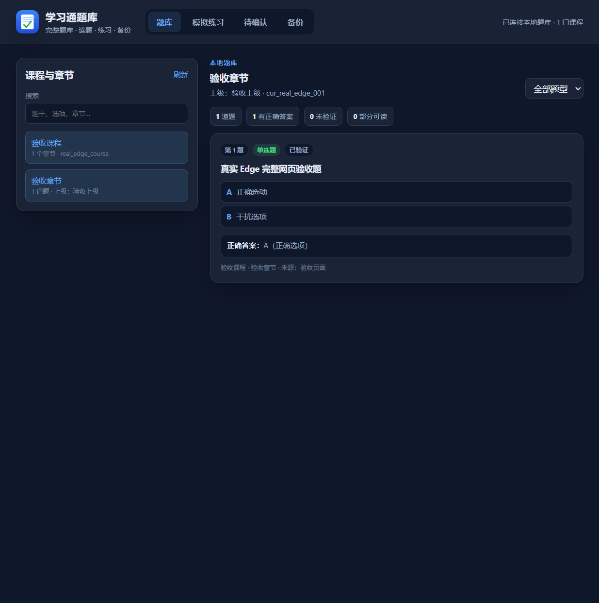

# 学习通课程题库助手

一个运行在 **Microsoft Edge / Chromium** 的本地题库扩展（Manifest V3），用于在用户主动操作后读取已展示的课程题目，建立本地题库，并在独立完整网页中读题、筛选和模拟练习。

> **项目状态**：代码与自动化测试已完成阶段性版本；真实 Edge 的扩展加载、popup、完整题库、本地存储写入读取和单题练习已验证。真实学习通页面提取、跨 frame 章节关联和批量保存仍待真实账号环境验收。
>
> **免责声明**：本项目与超星/学习通官方无隶属关系，仅供个人学习辅助。请遵守学校、课程和平台规则，不要用于考试作弊、绕过考试限制或抓取他人内容。



## 功能

- 从学习通章节题库/课程作业页读取已展示的题目、选项和答案；
- 支持单选题、多选题、判断题；
- 本地题库按课程、章节、题目身份去重；
- 完整题库网页：课程/章节浏览、搜索、题型筛选、题目阅读；
- 模拟练习：顺序/随机、判分、正确答案、进度和总结；
- pending（待确认）与未验证标记；
- JSON 备份导出/恢复；
- 仅在用户点击后读取当前标签页；不读取 Cookie、Token、账号密码或隐藏答案；无后端、无遥测。

## 安装（Edge）

1. 打开 `edge://extensions/`；
2. 打开左侧菜单，开启 **开发人员模式**；
3. 点击 **加载解压缩的扩展**；
4. 选择本项目目录（包含 `manifest.json`）；
5. 打开扩展 popup，点击顶部 **完整题库**，或在扩展页面打开：

```text
chrome-extension://<扩展ID>/popup/library.html
```

当前版本：`0.10.1`。

## 已验证与未验证

真实 Edge 已验证：

- 扩展可加载并启用；
- popup 页面可初始化；
- 完整题库页面可打开；
- 本地存储可写入和读取；
- 课程、章节、题目、选项和正确答案可显示；
- 完整页面单题练习、判分和总结可工作；
- 页面不显示测试 URL 的 query token。

尚未真实账号验证：

- 学习通真实页面识别和题目提取；
- 真实 frame 树和 `descendant` 章节关联；
- 真实批量保存、pending 和备份恢复；
- 多题、多选、判断、随机练习。

详细设计和开发记录见本文后半部分“早期开发记录”。本 README 前半部分描述当前公开使用方式。

## 测试

```bash
cd tools
npm install
npm test
```

字体夹具 `tools/fixtures/cxsecret-ceramic.ttf` 不随公开仓库分发。缺少它时，字体解码用例会跳过，其余测试继续运行。

## 许可证

代码以 [MIT License](LICENSE) 发布，版权署名 `jisekol`。

第三方资源见 [THIRD_PARTY_NOTICES.md](THIRD_PARTY_NOTICES.md)。其中 `content/vendor/cxsecret-table.js` 保留其原始 MIT 元数据；再分发或商业使用前请自行核验第三方数据权利。真实字体夹具不进入公开仓库。

## 安全

请阅读 [SECURITY.md](SECURITY.md)。不要在公开 Issue 中粘贴真实 Cookie、Token、账号、密码、未脱敏课程 URL 或私有题目数据。

---

以下为详细开发记录，保留用于追溯实现细节。

## 早期开发记录

面向 **Microsoft Edge** 的本地课程题库扩展（Chrome Manifest V3）。当前版本支持：

- 学习通章节题库的**单选题**和**多选题**；
- 课程作业页面的**单选题、多选题、判断题**；
- 作业答案页：读取页面已展示的“我的答案”“正确答案”、对错标识和分数；没有展示正确答案时保留 `null`，不推断；
- 章节测验答案：读取 `.newAnswerBx` 中已展示的 `.myAnswer`、`.correctAnswer`，保留每道题自己的答案；没有正确答案时保留 `null`，不推断；
- 章节身份：从 `#coursetree` 选中节点的 `id` 读取 `chapterId`，携带 `chapterIdSource`、`chapterIdStatus`；只在唯一、无歧义时标记稳定身份；
- frame 来源：snapshot 和题目解析保留 `frameId`；题目携带 `chapterLinkStatus`，区分同 frame、跨 frame 和多题目 frame 歧义；
- 模拟练习：从本地正式题库按课程/章节开始顺序或随机练习，支持单选、多选、判断，提交后判分、显示正确答案/解析、进度和总结；
- 完整题库网页：`popup/library.html`，可从弹窗“完整题库”打开，支持课程/章节浏览、搜索、题型筛选、练习、pending 和 JSON 备份；
- 课程名称跨标签页关联：课程主页保存 URL 课程索引到 `chrome.storage.local`，作业页按 courseId/classId/cpi 查找；
- 兼容同 tab 上下文：URL 标识不完整时使用原 `chrome.storage.session` 上下文；
- 课程学习页识别：`/mycourse/studentstudy` 识别为 `chapterStudy`，不再用“学生学习页面”当课程名；
- 课程目录：从 `#coursetree` 提取当前选中章节和上级章节；
- 受保护文字的识别与标记；
- 在弹窗中预览题目结构，不自动保存、不自动提交。

> 当前版本：`0.10.1`
>
> 本项目只读取你本人已登录、且页面实际展示的内容；不读取隐藏答案文本、账号密码、Cookie 或登录凭证，不绕过平台权限或考试安全限制。

## 本版本新增

- 跨标签页课程索引：课程页保存 courseId + classId + cpi 组合键到 `chrome.storage.local`；作业页即使课程页已关闭、在新标签页也能关联；
- courseId/classId 别名归一：`courseId`/`courseid`，`classId`/`classid`/`clazzid`；不读取 `enc`；
- 原有课程上下文：保留 `chrome.storage.session` 的同 tab 兼容方案，但 URL 标识匹配优先，不会被兼容上下文覆盖；
- 章节识别：新增 `.ceyan_name h3` 可信候选，允许识别“题库03-001”这类章节名，普通 heading 仍走严格规则；
- 字体还原：解析当前页面 CSS 内嵌 Base64 TTF，按字形路径哈希查表，把 `font-cxsecret` 假字还原为真实汉字；
- 容器归属修复：拒绝包含多个题目边界的父容器，优先选择最内层单题容器；选项必须归属于当前题目边界；
- 修复外层 `.singleQuesId` 把多道作业题合并，导致第一题多出第三题 E 选项的问题；
- 章节题库：取消“多选题提前跳过”，支持 `li[role=checkbox]`、`.num_option_dx`，输出 `multiple_choice`；
- 章节题库：单选 `single_choice` 与多选 `multiple_choice` 可以混合出现在同一页；
- 课程作业：新增独立适配，支持 `typename`、`h3.mark_name`、`.stem_answer`、`.answerBg[role=radio]`、`.answer_p`；
- 课程作业：新增 `li.workTextWrap` 选项和判断题 `li[tabindex="0"]` 选项；单选、多选、判断均不再跳过；填空/简答仍明确统计并跳过；
- 作业答案页：新增 `extractAnswerInfo()`，只读取当前 `.questionLi` 内可见的 `.stuAnswerContent`、`.rightAnswerContent`、`.marking_dui`、`.marking_cuo`、`.totalScore i.custom-style`；
- 答案安全边界：排除 `.element-invisible-hidden`、`hidden`、`aria-hidden="true"` 和样式隐藏节点；没有正确答案时 `correct: null`，没有对错图标时 `result: "unknown"`；
- 章节答案：新增 `.newAnswerBx` / `.myAnswer` / `.correctAnswer` 的答案排除与提取；每题按当前 `.TiMu` 容器读取，避免串题；答案标签不进入题干/选项；
- 判断题合并：`mergeQuestionFrames()` 允许 `judgment` 通过，`makeQuestionKey()` 保留 judgment 类型，避免被静默丢弃或与单选题去重；
- 章节身份传递：`extractCatalog()` 读取选中节点 id，`classifier` 传递 `chapterId`/状态，`buildQuestion()` 保留 `chapterId`、`frameId` 和 `chapterLinkStatus`；
- 已实现章节身份/frame 来源传递，并已完成本地题库保存、完整题库页面和模拟练习；
- 弹窗：卡片和统计区分单选题/多选题/判断题；作业卡片显示我的答案、正确答案、答题结果、分数；

## 文件变更（0.4.x / 0.5.0 / 0.6.x / 0.7.x / 0.8.x）

| 文件 | 作用 |
| --- | --- |
| `manifest.json` | 版本 `0.10.0`；权限为 `activeTab`、`scripting`、`storage`、`webNavigation` |
| `content/question-parser.js` | 章节题库单选/多选、作业单选/多选/判断、作业答案、章节答案、容器与选项归属修复；优先使用字体还原后的文字 |
| `content/cxsecret.js` | 本地字体解码：扫描内嵌 Base64 TTF、解析字形、查表还原、报告 unknown |
| `content/vendor/typr.js` | Typr.js（MIT）字体解析器，静态打包 |
| `content/vendor/cxsecret-table.js` | 20,906 条形字形路径哈希 → 真实 Unicode 映射 |
| `content/vendor/TYPR-LICENSE.txt` | Typr MIT 许可证 |
| `content/snapshot.js` | 增加 `.ceyan_name h3` 章节候选、可见课程链接候选、`#coursetree` 目录提取和选中节点 `chapterId` |
| `popup/classifier.js` | 增加 `chapterStudy` 类型；`.ceyan_name h3` 可信清洗；课程目录章节/上级章节；`chapterId` 与 frame 状态 |
| `popup/course-index.js` | URL 课程索引：courseId/classId/cpi 归一、组合键、本地保存与唯一匹配 |
| `popup/course-context.js` | 同 tab 课程上下文兼容方案（session） |
| `tools/test-cxsecret.js` | 字体算法与解析器端到端测试 |
| `tools/test-course-index.js` | 跨标签页 URL 课程索引测试 |
| `tools/test-course-context.js` | 同 tab 课程上下文、章节可信候选和跨页关联测试 |
| `tools/test-chapter-study.js` | `#coursetree` 目录、chapterId、chapterStudy 与上级章节测试 |
| `tools/fixtures/cxsecret-ceramic.ttf` | 真实字体子集；仅本地测试，不随公开仓库分发 |
| `THIRD_PARTY_NOTICES.md` | Typr / 映射表 / 测试字体的来源与许可说明 |
| `popup/popup.js` | 课程页保存 URL 索引和 session 上下文；章节学习页/章节测验/练习查询索引；snapshot 保留 frameId；预览显示章节身份、作业答案、答题结果和分数 |
| `popup/popup.html` | 加载课程索引与课程上下文模块；状态/标题文案支持题目提取和答案预览 |
| `popup/popup.css` | 增加题目预览的课程/章节上下文行和答案行样式 |
| `tools/test-question-parser.js` | 39 个解析测试，包含 4/4/5 容器归属回归、作业答案页和章节答案夹具 |
| `tools/test-answer-ui.js` | 3 个答案卡片 UI 测试：AD 映射、未展示、错误结果 |
| `tools/test-judgment-merge.js` | 6 个判断题合并/去重测试 |
| `tools/test-chapter-identity.js` | 5 个章节身份与 frame 来源测试 |
| `tools/fixtures/answer-pages.js` | 两份脱敏作业答案页夹具和一份章节答案夹具 |
| `tools/test-recognition.js` | 16 个页面识别测试，未修改 |
| `tools/test-popup-timeout.js` | 页面识别超时、顶层回退和按钮恢复测试 |
| `tools/test-course-routing.js` | courseHome/chapterQuiz/practice/other 的课程索引路由测试 |
| `README.md` | 更新到 0.10.0 的功能、结构和测试说明 |

已实现章节身份/frame 来源传递、本地题库、完整题库页面和模拟练习；解析器、答案识别、字体处理和课程索引规则保持独立。

## 在 Edge 中重新加载

1. 打开 `edge://extensions/`；
2. 找到「学习通课程题库助手」→ **重新加载**；
3. 关闭旧弹窗，重新点击工具栏图标；
4. 确认版本为 `0.10.0`；
5. 权限为 `activeTab`、`scripting`、`storage`、`webNavigation`，没有新增网站 host 权限。

## 使用步骤

1. 登录学习通，打开章节题库（单选/多选）或课程作业（单选/多选/判断）页面；
2. 点击扩展 →「页面识别」确认页面类型；
3. 切换到「题目预览」→「读取当前页面题目」；
4. 查看结构数量、单选/多选数量、文字状态、题干和选项；
5. 对照页面人工检查。

扩展只读取当前标签页当前展示的题目，不滚动、不翻页、不点击“下一题”，不提交。

## 统一数据结构

单选题和多选题共用同一结构，仅 `type` 不同：

```json
{
  "id": "sc_1a2b3c4",
  "number": 1,
  "type": "single_choice",
  "stem": "题干（ ）",
  "stemTextStatus": "ok",
  "options": [
    { "label": "A", "text": "甲", "textStatus": "ok" },
    { "label": "B", "text": "乙", "textStatus": "ok" }
  ],
  "optionCount": 2,
  "textStatus": "ok",
  "textMessage": "",
  "course": "课程名称",
  "chapter": "章节名称",
  "sourceUrl": "https://...",
  "sourceTitle": "页面标题",
  "media": []
}
```

多选题只是把 `type` 改为：

```json
"type": "multiple_choice"
```

字段说明：

| 字段 | 说明 |
| --- | --- |
| `id` | 稳定哈希；受保护/部分可读题按来源、题号、选项字母生成 |
| `number` | 页面题号；读不到时按当前页顺序生成 |
| `type` | `single_choice` 或 `multiple_choice` |
| `stem` | 题干；题干不可读时为 `null` |
| `stemTextStatus` | 题干的文字状态 |
| `options` | 选项；`label` 为 A-E 等，`text` 不可读时为 `null` |
| `options[].textStatus` | 每个选项独立的文字状态 |
| `optionCount` | 选项数量，受保护题也能确定 |
| `textStatus` | 整题汇总：`ok`、`mixed`、`protected_text`、`unreadable` |
| `textMessage` | 状态说明 |
| `course` / `chapter` | 课程/章节，未知为 `null` |
| `sourceUrl` / `sourceTitle` | 来源 |
| `media` | 图片/公式引用 |

### 文字状态

| 状态 | 含义 |
| --- | --- |
| `ok` | 文字可读 |
| `mixed` | 部分题干/选项可读，部分受保护或不可读 |
| `protected_text` | 文字疑似字体保护，未读取 |
| `unreadable` | 没有可读文字，也没有可保留的图片/公式占位 |

只有整题 `textStatus === "ok"` 才计入“完全可读”；`mixed` 和 `protected_text` 都不会被当成完整提取成功。

## 章节题库 DOM 规则

### 容器

- `.singleQuesId`
- `.TiMu` / `.TiMu.newTiMu`
- `.questionLi[typename]` / `.questionLi.fontLabel.singleQuesId`
- 兼容 `.questionLi`、`.question-item`、`.que-item`、`.exam-question`、`.subject-item`、`[data-questionid]` 等

`singleQuesId` 和带 `typename` 的作业容器优先于通用 `.questionLi`，避免外层 `.questionLi` 把整页当成一道题。

容器归属规则（0.4.1）：

- 一个候选容器如果内部包含多个 `.questionLi` / `.TiMu` / `.singleQuesId` 题目边界，则判定为列表/页面容器，不再作为单题解析；
- 在合法候选里优先选择最内层单题容器；外层 `.singleQuesId` 只在内部没有更具体单题容器时兜底；
- 每个 `.answerBg` / `li[role=radio]` 还必须通过“最近题目边界”校验，只能归属于当前题目；
- 不会把选项数量限制为 4，合法的 E 选项会保留。

### 题型

- `.newZy_TItle`：`【单选题】` / `【多选题】`；
- `.q_type`、`.font-cx`、`typename`、`.colorShallow`；
- 题干开头题型标记；
- 可见 radio/checkbox。

`【多选题】` 输出 `multiple_choice`；不再提前跳过。

### 题号

- `.Zy_TItle > i`；
- `.q_num`；
- `h3.mark_name` 开头题号；
- 题干前缀；
- 顺序兜底。

### 选项

- 单选：`li[role=radio]`、`ul.Zy_ulTop > li`、`ul.Cy_ulTop > li`、`.mark_letter > li` 等；
- 多选：`li[role=checkbox]`；
- 字母：`.num_option`、`.num_option_dx` 的 `data` / `data-value` / `data-label` 等，读不到再读可见字母；
- 文字：`li > a.after > p`、`.answer_p`、`.option-text` 等；
- 隐藏 input 不参与选项计数。

### 图片/公式

- 题干/选项图片记录绝对地址和 `alt`；
- 公式图片、`math`、`mjx-container` 等记录引用；
- 不做 OCR，不猜图片文字。

## 课程作业 DOM 规则

作业页使用单独适配：

| 内容 | 选择器/属性 |
| --- | --- |
| 题目容器 | `.questionLi`；优先真实单题边界，外层 `.fanyaMarking.TiMu` 不当作题目 |
| 题型 | 容器 `typename`；辅助题干前缀 `(单选题)` / `(多选题)` / `(判断题)` |
| 题号 | `h3.mark_name` 开头题号 |
| 题干 | `h3.mark_name p` 或题干节点 |
| 选项项 | `.workTextWrap`；判断题使用当前题目内的 `li[tabindex="0"]` |
| 我的答案 | `.mark_answer .stuAnswerContent` |
| 正确答案 | `.mark_answer .rightAnswerContent` |
| 对错 | `.mark_answer .marking_dui` / `.marking_cuo` |
| 分数 | `.mark_answer .totalScore i.custom-style` |

处理规则：

- 题型优先读 `typename`，再用题干前缀辅助；
- 题干只取题目节点，不把页面标题、举报按钮、作业说明、题量、满分混入；
- 每道题独立 `.questionLi`，外层 `.fanyaMarking.TiMu` 和包含多个题目边界的父容器不会被当成一道题；
- 隐藏 input 不作为选项或答案；
- 作业单选、多选、判断均处理；填空/简答仍计入 `skippedHomeworkUnsupported` 并跳过，不猜测结构；
- 答案只从当前 `.questionLi` 的可见 `.mark_answer` 读取；`.element-invisible-hidden`、`hidden`、`aria-hidden="true"` 和样式隐藏节点不读取；
- 没有可见正确答案时 `correct: null`、`correctStatus: "not_visible"`；没有对错图标时 `result: "unknown"`；不得根据得分或我的答案推断。

## 页面分类、快照与题目解析

三个环节是分开的：

1. **页面分类**：`popup/classifier.js` 判断课程主页、章节测验、课程作业等；
2. **页面快照**：`content/snapshot.js` 只取标题、面包屑、课程名、章节名，不取题目；
3. **题目解析**：`content/question-parser.js` 按真实 DOM 取题，`popup.js` 负责合并、去重、预览。

`popup.js` 的 `handleExtract()` 不会因为 `pageType === "homework"` 就跳过解析；作业页面和章节题库都走同一个 `collectQuestionFrames()` 和合并流程，只是解析器内部按真实结构适配。

## 课程与章节上下文

0.7.0 使用跨标签页 URL 课程索引，并保留同 tab 上下文作为兼容：

### URL 课程索引

- 课程主页（`pageType === "courseHome"`）识别成功后，从正常 URL 读取：
  - `courseId` / `courseid`
  - `classId` / `classid` / `clazzid`
  - `cpi`
- `/mycourse/studentstudy` 识别为 `chapterStudy`，不使用“学生学习页面”做课程名，也不会保存/覆盖课程索引；
- 课程学习页优先通过 URL 课程索引恢复课程名；
- 保存到 `chrome.storage.local`，组合键为：
  `courseIndex:${courseId}:${classId}:${cpi || ""}`；
- 记录字段：`courseName`、`courseId`、`classId`、`cpi`、`updatedAt`、`source`；
- 不保存 `enc`、Token、Cookie 或其他凭证；
- 作业页、`chapterQuiz`、`practice` 页面从正常 URL 读取上述标识，必须同时有 courseId 和 classId；
- `other` 页面只有在 `/knowledge/`、`/chapter/` 或 `chapterId`/`knowledgeId` 等章节标识存在时，才按 URL 索引查询；
- 章节内容页即使被误判为 `courseHome`，也不会走课程索引保存分支，不会用章节标题覆盖课程索引；
- 双方都有 cpi 时必须一致；只有一方有 cpi 时不关联；双方都没有 cpi 时按 courseId + classId 关联；
- 找不到唯一记录时课程名为 `null`，不猜测；
- 匹配成功后 `courseNameSource` 为“URL课程索引关联”；
- 课程页关闭、没有 session 上下文，或作业页在新标签页打开时，只要索引匹配仍可关联。

### 同 tab 上下文兼容

- 课程主页仍会按 `tabId` 保存一份 `chrome.storage.session` 上下文，字段包含 `courseName`、`courseId`、`tabId`、`windowId`、`savedAt`、`expiresAt`、`source`；
- 有效期 2 小时；
- 只有作业 URL 完全没有 courseId/classId 时才使用该兼容上下文；
- chapterQuiz、practice 和章节内容页没有课程标识时不使用 session 猜测，避免错误关联；
- URL 只要有任一课程标识，就以 URL 索引结果为准，URL 索引不匹配时不会退回 tab 上下文，避免兼容数据覆盖或错误关联；
- 不同 tab 不共享 session 上下文。

### 章节识别

- 快照增加 `.ceyan_name h3` 候选；
- 只有明确来自 `.ceyan_name h3` 的候选使用 trusted 清洗，允许“题库03-001”；
- 普通 `h1/h2/h3`、面包屑、页面标题仍按原有严格规则；
- 保留长度、通用词、课程名相等、HTML 字符等保护；
- 题量、满分等作业信息不会被当作章节名。

### 课程学习页目录

课程学习页从 `#coursetree` 提取：

- 当前选中项：`#coursetree .posCatalog_select.posCatalog_active`；
- 小节名称：`.posCatalog_name`；
- 上级章节：选中项所属 `.posCatalog_level` 的父级 `LI` 中，直接子元素 `.posCatalog_select.firstLayer .posCatalog_title`；
- 没有选中项、多个可见选中项、没有 `#coursetree` 时返回 `null`，不猜测；
- 页面识别结果和题目预览增加 `parentChapterName`，章节仍使用 `chapterName`。

### 边界

- 课程索引只有在用户于课程页打开插件并触发识别时才会建立；
- 新标签页可以直接复用已建立的课程索引；
- 没有 courseId/classId、索引缺失、cpi 单边或冲突时，课程名为 `null`；
- 课程索引按 courseId + classId + cpi 区分，同一课程索引不会被其他课程覆盖；
- 只读取正常 URL 查询参数和可见页面内容，不读取隐藏字段、Cookie、Token 或隐藏接口。

## 页面识别超时保护

0.7.1 为页面快照增加超时：

- `chrome.scripting.executeScript({ allFrames: true })` 最多等待 5 秒；
- 全部框架失败或超时后，仅读取顶层页面，最多等待 3 秒；
- 顶层也失败或超时，`collectSnapshots()` 抛出受控错误，`analyzeCurrentTab()` 捕获后继续使用 URL 做基础页面识别；
- 超时不会伪造课程名或章节名；
- `handleRecognize()` 的 `finally` 会恢复按钮和加载状态；
- 超时只结束等待，不取消底层 Chrome API。

## 字体还原与文字保护

0.5.0 先尝试还原当前页面内嵌字体，再做文字保护判断：

1. `popup.js` 解析题目之前，先注入 `content/vendor/typr.js`、`content/vendor/cxsecret-table.js`、`content/cxsecret.js`；
2. 解码模块扫描当前页面 `<style>` 中的 Base64 TTF `@font-face`；
3. 用 Typr 解析 cmap/glyf，对字形路径 JSON 取 MD5，使用第 25~32 位查本地映射表；
4. 若当前页面字体能完整映射，则题干/选项直接使用还原后的真实汉字，`textStatus` 为 `ok`；
5. 若页面没有内嵌字体、外部字体、字体解析失败或存在映射表未覆盖字符，则保留原文字并标记 `protected_text` / `mixed`，不保存乱码；
6. 字体不可用时，仍沿用原有“`.font-cxsecret` + 字体名”启发式判断，不改变旧行为。

边界：

- 只读取当前页面 CSS 内嵌的 Base64 TTF，不下载字体文件；
- 不读取 Cookie、Token、隐藏接口；
- 不做 OCR、不做截图识别；
- 未命中映射表的字符不会猜测，整段标记为不可读；
- 不同页面字体映射不同，每次进入新页面重新提取当前字体，不复用上一页映射。

原有规则（字体不可用时）仍保留：宋体等明确可读字体正常提取；自定义字体/无法确定标记受保护；部分可读标记 `mixed`。

## 安全与隐私

- 仅点击按钮后读取当前标签页；
- 仅处理 `chaoxing.com` / `chaoxing.cn`；
- 非学习通页面不注入解析器；
- 考试页面直接拒绝；
- 不读取 `.Py_answer`、`.rightAnswer`、解析等答案区域；
- 不读取 Cookie、Token、账号密码、表单值；
- 无网络请求、无后端；Typr 与字形映射表是扩展内的本地静态资源；
- 不自动答题、提交、翻页；
- URL 课程索引只写入 `chrome.storage.local`，字段仅包含课程名、courseId、classId、cpi、更新时间和来源；不保存 enc、Token、Cookie；
- 同 tab 兼容上下文只写入 `chrome.storage.session`；
- 弹窗关闭后不保存题目内容，只在当前弹窗内存中预览。

## 自动化测试

```bash
cd tools
pnpm install

node test-recognition.js
node test-question-parser.js
node test-cxsecret.js
node test-course-context.js
node test-course-index.js
node test-course-routing.js
node test-chapter-study.js
node test-popup-timeout.js
node test-answer-ui.js
node test-judgment-merge.js
node test-chapter-identity.js
```

本次结果：

- 页面识别测试：**16 个全部通过**；
- 题目解析测试：**39 个全部通过**；
- 字体还原测试：**2 组全部通过**（算法查表 + 解析器端到端）；
- 课程上下文/章节测试：**15 个全部通过**；
- URL 课程索引测试：**10 个全部通过**；
- 课程上下文路由测试：**11 个全部通过**；
- 课程学习页目录测试：**13 个全部通过**；
- 页面识别超时测试：**8 个全部通过**；
- 答案卡片 UI 测试：**3 个全部通过**；
- 判断题合并/去重测试：**6 个全部通过**；
- 章节身份与 frame 来源测试：**7 个全部通过**。

解析测试覆盖：

- 章节单选回归；
- 章节多选 A-E 五选项；
- 单选 + 多选混合；
- 外层 `.singleQuesId` 包裹三题：4/4/5，Q1/Q2 无 E，Q3 保留 E “从性显性”；
- 三题并列 `.questionLi`：4/4/5 不受影响；
- 真实作业单选题结构；
- 作业题干不混入页面标题/作业说明；
- 作业单选、多选、判断；
- `.workTextWrap` 选项；
- 判断题 `li[tabindex="0"]` 选项；
- 答案页样本一：我的答案、正确答案、对错、分数；
- 答案页样本二：只有我的答案和分数，正确答案为 `null`；
- 章节答案：同答案、不同答案、只有我的答案、没有答案区、多题答案关联；
- 章节答案标签不进入题干/选项；
- 判断题通过 `mergeQuestionFrames()`，且与同题干单选不会误去重；
- 判断题未公布正确答案时 `correct: null`、`result: "unknown"`；
- 外层 `.fanyaMarking.TiMu` 不产生假题；
- `.element-invisible-hidden` 和 `aria-hidden` 文本不进入答案；
- 多选题 `AD` 与判断题答案不串题；
- `typename` 题型；
- 隐藏 input 不作为选项；
- 填空/简答题跳过；
- `.font-cxsecret` 宋体可读、受保护、部分可读；
- 内嵌 Base64 TTF 解析、MD5 字形指纹、真实假字还原；
- 原有全部解析测试。

课程上下文/章节测试覆盖：

- 课程主页 `document.title` 得到课程名；
- 同 tab 保存/读取课程上下文；
- 课程 B 覆盖课程 A；
- 不同 tab 不共享；
- 无上下文直接作业页返回 null；
- 过期返回 null 并清理；
- courseId 不一致返回 null 并清理；
- 双方 courseId 一致时允许关联；
- 仅课程页有 courseId 时拒绝并清理；
- 仅作业页有 courseId 时拒绝并清理；
- 双方无 courseId 时同 tab/有效期内关联；
- 可见课程链接提供 courseId；
- `.ceyan_name h3` 识别“题库03-001”；
- 普通 heading 仍拒绝“题库03-001”；
- 课程名与章节名不互相覆盖。

URL 课程索引测试覆盖：

- 课程页 A 保存索引，新标签页作业页 A 关联成功；
- 课程页关闭后，作业页仍能关联；
- 不同 courseId 拒绝；
- 不同 classId/clazzid 拒绝；
- cpi 不一致拒绝；
- 只有一方有 cpi 拒绝；
- 双方无 cpi 时按 courseId + classId 关联；
- 缺少课程标识返回 null；
- 同一课程索引不被其他课程覆盖；
- URL 别名/大小写归一，且不保存 enc。

课程上下文路由测试覆盖：

- courseHome 普通课程页仍走保存；
- courseHome 章节内容页改为查询，不覆盖索引；
- chapterStudy 查询课程索引；
- chapterStudy 标题推断值不阻止索引且不保存；
- chapterQuiz 查询课程索引；
- practice 查询课程索引；
- other 章节内容页查询课程索引；
- other 非章节页面不查询；
- 章节页没有课程标识时不使用 session 猜测；
- 已有课程名称不被索引覆盖；
- 题目预览数据包含 `parentChapterName`。

课程学习页目录测试覆盖：

- `/mycourse/stu` 仍识别为 courseHome；
- `/mycourse/studentstudy` 识别为 chapterStudy，且不用“学生学习页面”当课程名；
- `#coursetree` 当前选中小节提取；
- 上级章节提取；
- 没有选中项返回 null；
- 没有目录容器返回 null；
- 多个选中项不猜测；
- 上级章节被选中时允许作为 chapterName、parent 为空。

## 真实页面测试

我无法代替你登录学习通，因此**没有声称真实页面已通过**。请你在 Edge 中验证：

1. 重新加载 0.10.0；
2. 先打开课程主页，点击插件识别，确认课程名显示正确；这会建立 URL 课程索引；
3. **关闭课程页，或新开一个标签页**，进入该课程作业页；
4. 点击插件识别/提取，确认课程名来源显示“URL课程索引关联”；
5. 再打开该课程的章节内容页/章节测验/练习页，确认课程名也能通过 URL 索引关联；
6. 确认章节名显示 `.ceyan_name h3` 的“题库03-001”；
7. 检查不同 courseId、不同 classId、cpi 不一致的页面不会错误关联；
7. 章节题库：检查单选题仍正确、多选题显示为「多选题」、A-E 顺序正确；
8. 课程作业：检查单选题/多选题/判断题的题干、选项、题号，以及我的答案、正确答案、答题结果、分数；
9. 受保护题：检查“文字受保护/部分文字受保护”标记，且没有乱码文字；
10. 填空题/简答题：检查被跳过并统计，而不是误提取；
11. 没有正确答案的作业：确认卡片显示“正确答案：未展示”，不根据分数推断；

如结果不对，请提供对应题目的脱敏 outerHTML 骨架和弹窗提示文字。

## 已知限制

- 课程索引只在课程页打开插件并触发识别时建立；不打开插件直接进入作业页时，课程名保持 null。
- 课程索引依赖 URL 中可读取的 courseId、classId、cpi；作业 URL 缺少 courseId/classId 时无法使用 URL 索引。
- courseId + classId 不存在唯一匹配时返回 null，不猜测。
- 只有一方有 cpi 时拒绝关联；双方都无 cpi 时只按 courseId + classId 关联。
- 同 tab session 上下文仅作为兼容方案，且只在 URL 完全没有 courseId/classId 时使用；不会覆盖 URL 索引结果。
- 字体还原只支持当前页面 CSS 内嵌的 Base64 TTF；外部 `@font-face` URL、WOFF/WOFF2、跨域样式表暂不支持，仍按 protected 处理。
- 映射表覆盖 20,906 个常用汉字；未命中字符不会猜测，整段标记为不可读，不保存乱码。
- 不同页面字体映射不同，每次必须使用当前页面字体；映射表本身的来源/再分发许可尚未最终确认，个人原型使用，发布前应替换为自建 OFL 映射表。
- 如果字体解码模块注入失败（跨域 iframe 等），会退回原有字体名启发式判断，可能误标普通文本。
- 作业支持单选、多选、判断；填空、简答会跳过。
- 章节答案当前适配已验证的 `.newAnswerBx` 结构；章节判断题、随堂练习页面适配和教师解析提取尚未开发。
- 作业答案只读取页面已展示的 `.mark_answer` 可见内容；章节答案只读取当前 `.TiMu` 内 `.newAnswerBx` 的可见内容；页面未展示正确答案时保持 `null`，不推断、不访问隐藏接口。
- 章节题库依赖当前真实结构；其他学校/改版页面可能需要补充选择器。
- 跨域 iframe 可能读不到；同源子框架可尝试。
- 只读取当前页面当前展示的题目，不滚动、不翻页、不展开折叠内容。
- 暂无题目持久化、搜索、分类、导出；课程索引保存在 `chrome.storage.local`，不含 enc/Token/Cookie。
- 页面快照超时后仍可能保留一个未完成的底层的 Chrome 注入 Promise；UI 已不再等待它，但浏览器 API 本身不可取消。

## 版本记录

- `0.10.0`（2026-10-31）：新增模拟练习：顺序/随机练习、单选/多选/判断、判分、正确答案/解析展示、进度与总结；新增 `practice.js` 和练习测试。
- `0.9.0`（2026-10-31）：新增章节身份与 frame 来源传递。`extractCatalog()` 读取选中节点自身 id；classifier 传递 chapterId/状态；snapshot 和题目保留 frameId；buildQuestion 标记 chapterLinkStatus。未实现本地题库保存。
- `0.8.2`（2026-10-31）：修复 `mergeQuestionFrames()` 丢弃 `judgment` 的问题；`makeQuestionKey()` 保留 judgment 类型；新增判断题合并/去重测试。
- `0.8.1`（2026-10-31）：新增章节测验 `.newAnswerBx` 答案识别，读取 `.myAnswer`、`.correctAnswer`；答案按当前 `.TiMu` 关联；没有正确答案时保持 `null`；新增章节答案夹具。
- `0.8.0`（2026-10-31）：作业页支持单选/多选/判断；新增 `.workTextWrap` 和判断题选项；新增可见答案提取（我的答案、正确答案、对错、分数）；未展示正确答案保持 `null`；新增脱敏答案页夹具与回归测试。
- `0.7.1`（2026-10-31）：新增 `chapterStudy` 课程学习页识别和 `#coursetree` 目录章节/上级章节提取；页面快照增加 5 秒 allFrames、3 秒顶层超时和顶层回退。
- `0.7.0`（2026-10-31）：新增跨标签页 URL 课程索引（courseId/classId/cpi 组合键、`chrome.storage.local`）；URL 索引优先，同 tab session 仅兼容无 URL 标识场景。
- `0.6.1`（2026-10-31）：收紧课程上下文 courseId 校验；只有双方都有且一致或双方都没有时才允许关联，单边有 ID 也拒绝并清理。
- `0.6.0`（2026-10-31）：新增课程上下文跨页关联（`chrome.storage.session`、tabId/windowId/courseId/TTL）；新增 `.ceyan_name h3` 可信章节候选与“题库03-001”识别测试。
- `0.5.0`（2026-10-31）：新增内嵌 Base64 TTF 字体还原；Typr 解析 + 字形路径 MD5 查表；解析器自动使用还原后的文字，未知字符仍标记 protected。
- `0.4.1`（2026-10-31）：修复外层 `.singleQuesId` 被误当单题容器导致多题选项合并；增加选项归属校验和 4/4/5 回归测试。
- `0.4.0`（2026-10-31）：章节题库支持单选/多选；新增作业单选题适配；文字保护改为题干/选项分别判断。
- `0.3.1`（2026-10-31）：适配 `.singleQuesId` / `.newZy_TItle` / `li[role=radio]` / `.num_option`，增加受保护文字标记。
- `0.3.0`（2026-10-31）：新增当前页面单选题提取、预览、跨框架合并与去重。
- `0.2.0`（2026-10-31）：新增页面识别、页面类型、课程名与章节名。
- `0.1.0`（2026-10-31）：完成 Manifest V3 基础框架。
